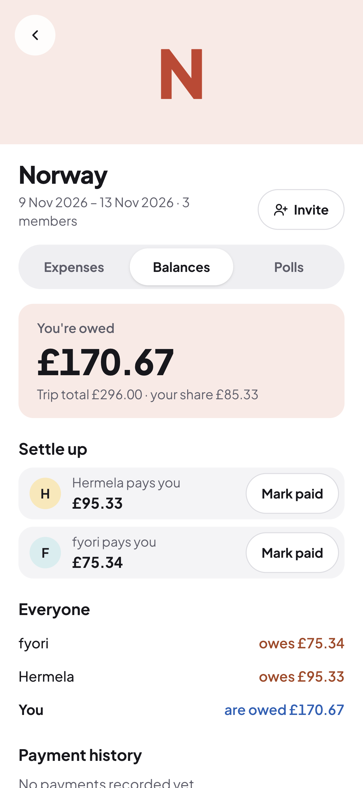
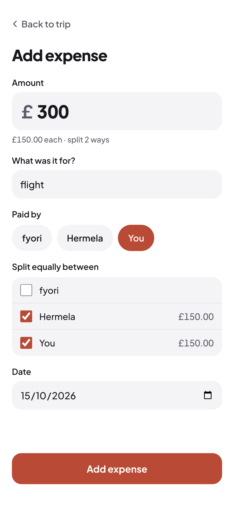

# Huddle

**Plan group trips and split costs without the awkward maths.**

Huddle is a group trip planner. You create a trip and share an invite link. Everyone logs what they paid, and Huddle works out who owes whom. It gives you the fewest payments needed to settle up. You can also run quick polls to make decisions together.

**Live app:** https://huddle-hh-9a09.vercel.app

🔒 See [SECURITY.md](SECURITY.md) for the OWASP Top 10 review I ran on this app.

<p>
  
  
  
</p>

## Features

- **Trips and invites:** create a trip and share a link to invite friends. The organiser can reset the link if it leaks.
- **Expenses:** log who paid and who it's for. Each expense is split equally, with a live preview of everyone's share.
- **Balances and settle-up:** see who's owed and who owes, plus the shortest list of payments to settle everything (at most *n − 1*).
- **Payments:** mark a payment as paid and undo it if it was a mistake.
- **Polls:** ask the group (e.g. "Which weekend?"), vote, and close the poll when it's decided.
- **Accounts:** email sign-up with confirmation. Invite links still work if you need to sign up first.

## Tech stack

| Layer | Choice |
|---|---|
| Frontend | React 19, TypeScript, Vite, React Router |
| Styling | Tailwind CSS v4 (design tokens in `@theme`), designed in Figma |
| Backend | Supabase: Postgres, Auth, Row Level Security, SQL functions |
| Testing | Vitest (47 unit tests on the money and poll logic) |
| Hosting | Vercel (auto-deploys from `main`) |

## Design decisions

**Money is stored as whole pence (integers), never decimals.** Floating point can't represent values like 0.1 exactly, so totals drift by fractions of a penny. Integers are exact. Amounts are parsed from text, so "12.5" becomes 1250 without ever being a float.

**Leftover pennies are shared fairly and predictably.** £10 split three ways is 334 + 333 + 333 pence. The extra penny goes to people in the order they joined the trip. The order is documented, so it's consistent and never random.

**Stored shares are the source of truth.** Each person's share is saved when the expense is created. Balances are calculated from those saved shares, not re-split each time. So if someone joins the trip later, old expenses don't change.

**Settle-up uses a greedy algorithm.** It repeatedly matches the person owed the most with the person who owes the most. This needs at most *n − 1* payments for *n* people.

**Security lives in the database, not just the UI.** Every table has Row Level Security policies. For example, you can only see trips you're a member of, and only the creator or organiser can edit an expense. Even if someone calls the API directly, Postgres refuses.

**Multi-step writes are transactions.** Saving an expense writes the expense and every person's share in one SQL function (`save_expense`). It either fully succeeds or fully fails, so you never get an expense with missing shares. Polls work the same way (`create_poll`).

**Closed polls are final.** A database trigger blocks reopening or editing a closed poll, so results can't be changed after the fact.

**Validation messages say exactly what's wrong.** Amount errors are specific ("Use at most 2 decimal places, like 12.50", "The amount can't be negative"), not a generic "invalid amount". A £20m technical maximum protects the database without assuming what a "normal" trip costs.

More detail is in the product requirements doc: [`Huddle_PRD.pdf`](Huddle_PRD.pdf).

## Project structure

```
src/
  lib/          money.ts, polls.ts: pure logic, unit-tested
  pages/        one file per screen
  components/   tabs (Expenses, Balances, Polls) and shared UI
  auth/         session provider and route guard
supabase/       schema, RLS policies and SQL functions
```

## Running locally

1. Clone the repo and run `npm install`.
2. Create a Supabase project. In its SQL editor, run the files in `supabase/` in this order: `schema.sql`, `policies.sql`, `expenses.sql`, `payments.sql`, `polls.sql`.
3. Create `.env.local`:
   ```
   VITE_SUPABASE_URL=your-project-url
   VITE_SUPABASE_PUBLISHABLE_KEY=your-publishable-key
   VITE_SITE_URL=http://localhost:5173
   ```
4. Run `npm run dev`. Run `npm test` for the tests.

## What's next

- Trip cover photos
- Unequal splits (by amount or percentage)
- Real-time updates when friends add expenses
- Partial payments
